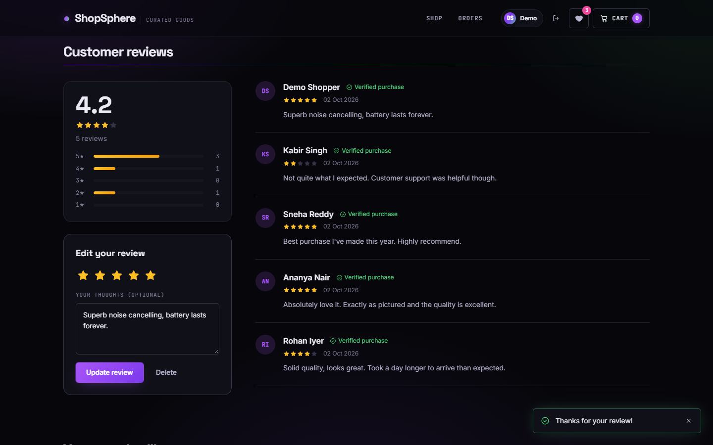
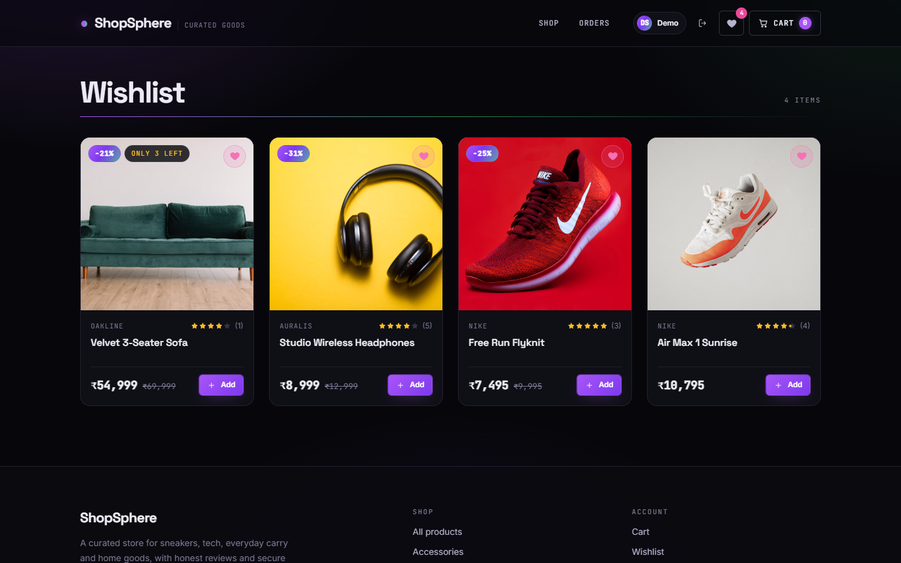
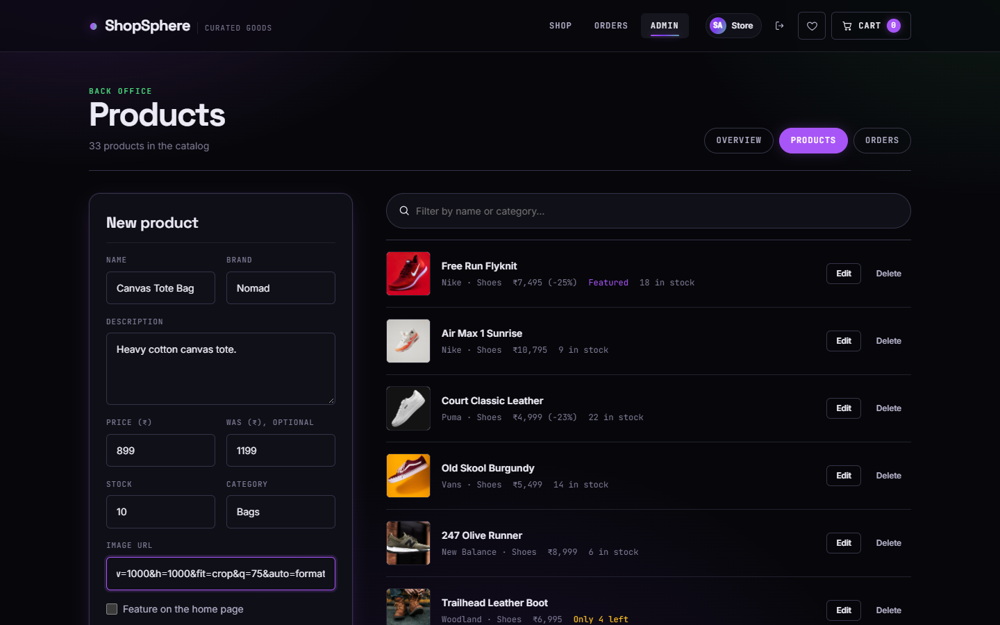
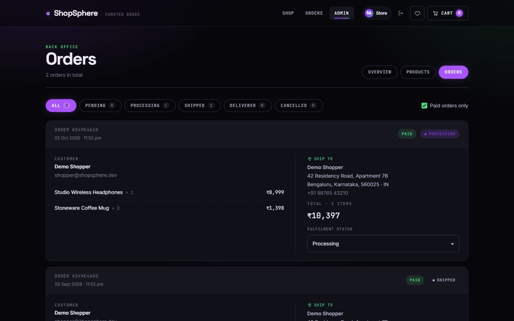
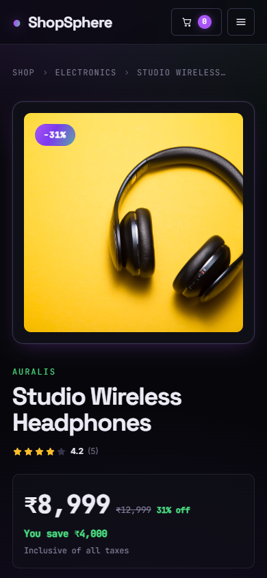
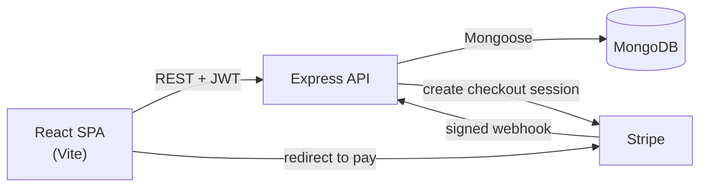

# ShopSphere

A full-stack e-commerce store built with the **MERN stack** and **Stripe**: a catalog with search and filters, reviews and ratings, a wishlist, a cart, hosted checkout with shipping addresses, order tracking, and an admin back office.

> 📐 **Studying for interviews?** Read [`docs/SYSTEM_DESIGN.md`](docs/SYSTEM_DESIGN.md). It walks through the architecture, data model, payment flow, concurrency, indexing and scaling, with diagrams and likely interview questions.


## Features

**Shopping**
- Catalog of 33 products in 5 categories, with live search (name or brand), category filters, an on-sale filter, sorting (newest, top rated, price, name) and pagination. Filters live in the URL.
- Home page with a featured-product hero, category tiles, "Editor's picks" and "On sale now" rails
- Product pages with brand, sale price and savings, stock status, quantity picker and related products
- **Ratings & reviews**: 1–5 stars with comments, one review per customer (edit or delete), a rating breakdown and **verified purchase** badges
- **Wishlist** synced to your account, with a navbar counter
- **Cart** saved in the browser and re-checked against live prices and stock, with sale savings shown
- **Stripe Checkout** with shipping address and phone collection; prices always computed on the server
- **Order history** with item thumbnails, delivery progress tracker, shipping address, and cancelling unpaid orders

**Admin**
- Dashboard: revenue, paid orders, orders awaiting fulfilment, low-stock alerts and recent orders
- Product editor: brand, sale price, stock, image preview, "featured" toggle, and free-form categories (new categories appear site-wide automatically)
- Order management: filter by status, see the customer and shipping address, and move orders from Pending → Processing → Shipped → Delivered

**Engineering highlights** (details in the [system design doc](docs/SYSTEM_DESIGN.md))
- **Idempotent payment settlement**: an atomic conditional update means duplicate webhooks or a webhook racing the success page decrement stock exactly once (covered by a concurrency test)
- Stripe webhook signature verification; expired checkouts are cancelled automatically
- Server-side pricing, whitelisted writable fields, ownership checks and role-based access
- Data modelling: embedded reviews with a denormalised rating, order-item snapshots, wishlist references, derived categories via aggregation
- Indexes for every catalog filter/sort combination; no N+1 queries in cart validation
- Optimistic concurrency (version conflicts become `409`), atomic `$addToSet` / `$pull`
- Helmet headers, auth rate limiting, CORS allow-list, centralised error handling
- **84 integration tests** and GitHub Actions CI (MongoDB service container, lint, build)

## Tech stack

| Layer | Tools |
| --- | --- |
| Frontend | React 19, React Router 7, Vite, Axios, custom CSS design system (dark "Neon Night" theme) |
| Backend | Node.js, Express 5, Mongoose 9, JWT, bcrypt, Helmet, express-rate-limit |
| Payments | Stripe Checkout + webhooks |
| Database | MongoDB (Atlas or local) |
| Tooling | ESLint, Node's built-in test runner, GitHub Actions |

## Screenshots

| Product page | Reviews |
| --- | --- |
|  |  |

| Cart | Wishlist |
| --- | --- |
|  |  |

| Order history | Admin dashboard |
| --- | --- |
|  |  |

| Admin: products | Admin: orders |
| --- | --- |
|  |  |

<p align="center">
  
  &nbsp;&nbsp;
  
</p>

## Architecture



## Getting started

### Prerequisites
- Node.js 20+
- MongoDB: [Atlas](https://www.mongodb.com/atlas) (free tier) or a local install
- A [Stripe](https://dashboard.stripe.com/register) account in test mode

### 1. Install

```bash
git clone https://github.com/CelestialCoder07/shopsphere.git
cd shopsphere
cd server && npm install
cd ../client && npm install
```

### 2. Configure

```bash
cp server/.env.example server/.env
cp client/.env.example client/.env   # optional; defaults to http://localhost:5000/api
```

| Variable (`server/.env`) | Purpose |
| --- | --- |
| `PORT` | API port (default `5000`) |
| `MONGO_URI` | MongoDB connection string |
| `JWT_SECRET` | Long random string used to sign tokens |
| `STRIPE_SECRET_KEY` | Stripe test secret key (`sk_test_…`) |
| `STRIPE_WEBHOOK_SECRET` | Webhook signing secret (`whsec_…`, see step 5) |
| `CLIENT_URL` | Frontend URL, used for CORS and Stripe redirects |
| `SEED_ADMIN_EMAIL` / `SEED_ADMIN_PASSWORD` | Optional admin login created by the seed script |

> Using Atlas? Add your IP address under **Network Access**, or the API can't connect.

### 3. Load the sample catalog

```bash
cd server
npm run seed             # adds the 33-product catalog (with reviews) if empty
npm run seed -- --reset  # replaces all products; orders and users are kept
```

| Role | Email | Password |
| --- | --- | --- |
| Admin | `admin@shopsphere.dev` | `admin123` (or `SEED_ADMIN_PASSWORD`) |
| Customer | `shopper@shopsphere.dev` | `shopper123` |

### 4. Run

```bash
cd server && npm run dev   # http://localhost:5000
cd client && npm run dev   # http://localhost:5173
```

### 5. Test payments

Pay with Stripe's test card `4242 4242 4242 4242`, any future expiry date and any CVC. To receive webhooks locally:

```bash
stripe listen --forward-to localhost:5000/api/payment/webhook
```

Put the printed `whsec_…` value in `STRIPE_WEBHOOK_SECRET`. Without the Stripe CLI, payments still settle through the success page.

## Tests

```bash
cd server && npm test                      # 84 API integration tests (needs MONGO_URI)
cd client && npm run lint && npm run build
```

Tests create uniquely named data and delete it afterwards. Point them at a local or throwaway database.

## API reference

| Method | Endpoint | Access |
| --- | --- | --- |
| `POST` | `/api/auth/register` · `/api/auth/login` | Public (rate limited) |
| `GET` | `/api/auth/profile` | Signed in |
| `GET` | `/api/products?search&category&sort&page&limit&onSale&featured` | Public |
| `GET` | `/api/products/categories` | Public |
| `GET` | `/api/products/:id` | Public |
| `POST` `DELETE` | `/api/products/:id/reviews` | Signed in (own review) |
| `POST` `PUT` `DELETE` | `/api/products[/:id]` | Admin |
| `GET` | `/api/users/me/wishlist` | Signed in |
| `PUT` `DELETE` | `/api/users/me/wishlist/:productId` | Signed in |
| `GET` | `/api/orders/myorders` | Signed in |
| `GET` | `/api/orders/:id` | Owner or admin |
| `PUT` | `/api/orders/:id/cancel` | Owner, unpaid orders only |
| `GET` | `/api/orders` | Admin |
| `PUT` | `/api/orders/:id/status` | Admin |
| `POST` | `/api/payment/create-checkout-session` | Signed in |
| `GET` | `/api/payment/verify?sessionId=…` | Signed in |
| `POST` | `/api/payment/webhook` | Stripe (signature verified) |

## Deployment

1. **Database:** MongoDB Atlas. Allow access from your host (`0.0.0.0/0` for most free hosts).
2. **API:** [Render](https://render.com) web service with root directory `server`, build `npm install`, start `npm start`. Add every variable from `server/.env`, with `CLIENT_URL` set to your frontend URL.
3. **Frontend:** [Vercel](https://vercel.com) with root directory `client` and the Vite preset. Set `VITE_API_URL=https://<your-api>.onrender.com/api`. `client/vercel.json` already handles client-side routes.
4. **Stripe:** add a webhook endpoint at `https://<your-api>.onrender.com/api/payment/webhook` for `checkout.session.completed` and `checkout.session.expired`, and copy its secret into `STRIPE_WEBHOOK_SECRET`.
5. Run `npm run seed` once against the production database, with a strong `SEED_ADMIN_PASSWORD`.

## Project structure

```
shopsphere/
├── client/                    React + Vite frontend
│   └── src/
│       ├── api/               Axios client + endpoint helpers
│       ├── components/        ProductCard, Stars, Price, WishlistButton, guards…
│       ├── context/           Auth, cart and toast providers
│       ├── hooks/             useAsync, useWishlist, useCategories, useSignOut…
│       ├── pages/             Storefront, account and admin screens
│       └── styles/            Tokens, base, components, theme, store
├── server/                    Express API
│   ├── scripts/               seed.js + catalog.js (sample data)
│   ├── src/
│   │   ├── config/            MongoDB and Stripe clients
│   │   ├── controllers/       Route handlers
│   │   ├── middleware/        Auth, admin, rate limit, errors
│   │   ├── models/            User, Product (+ reviews), Order
│   │   ├── routes/
│   │   └── utils/             Cart resolution, Stripe address parsing
│   └── tests/                 Integration tests
├── docs/
│   ├── SYSTEM_DESIGN.md       Architecture & interview guide
│   └── screenshots/
└── .github/workflows/ci.yml
```

## Roadmap

- httpOnly cookie sessions with refresh tokens
- Stock reservation during checkout
- Image uploads (Cloudinary/S3) and multi-image galleries
- Order confirmation emails via a background queue
- Full-text search (Atlas Search)

## Credits

Product photos are from [Unsplash](https://unsplash.com), used under the [Unsplash License](https://unsplash.com/license). Brand names in the sample catalog appear for demonstration only. This is a non-commercial practice project.
