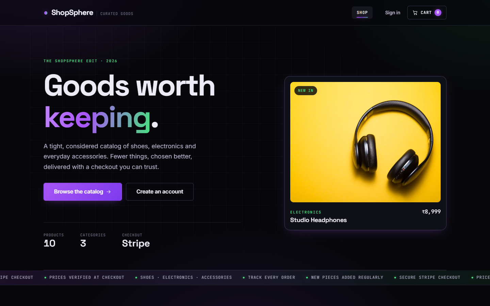
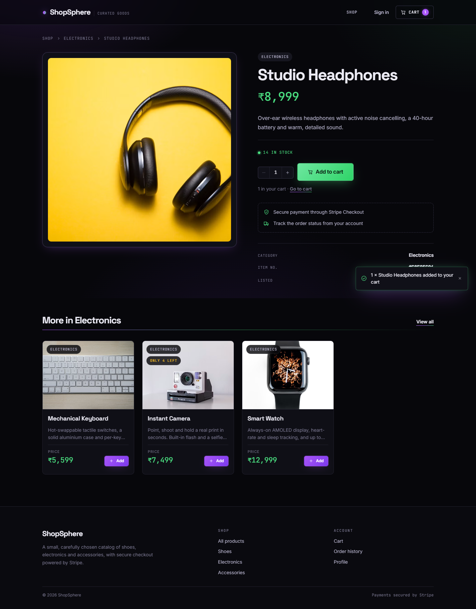
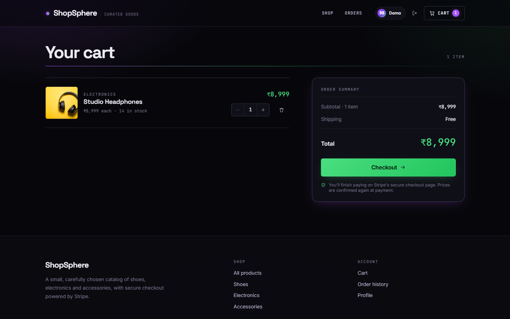
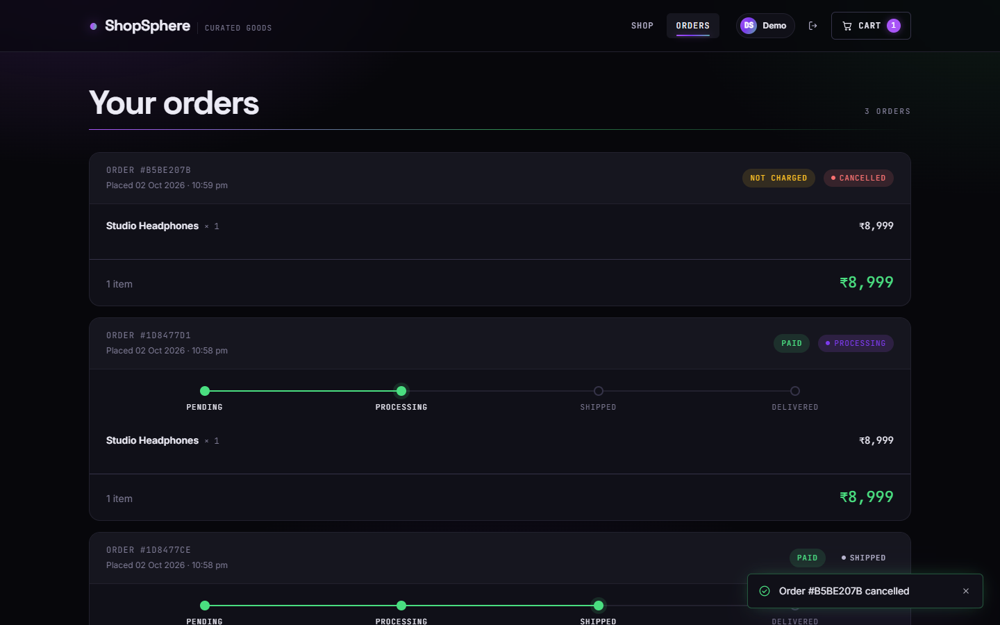
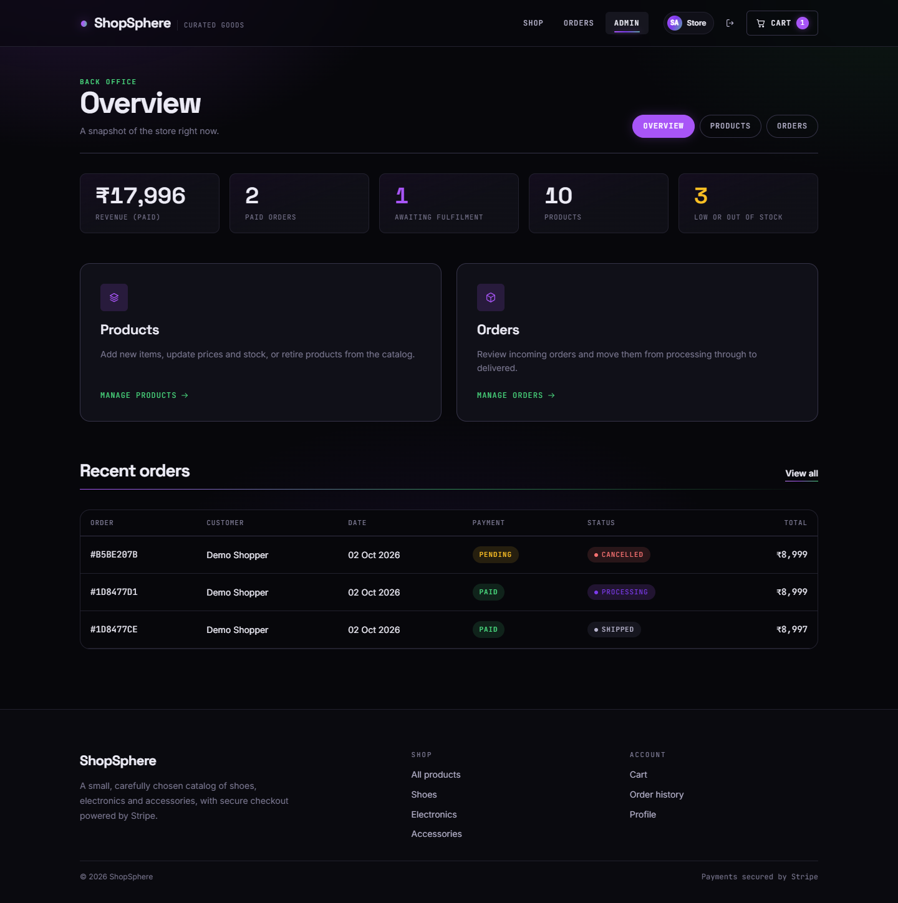
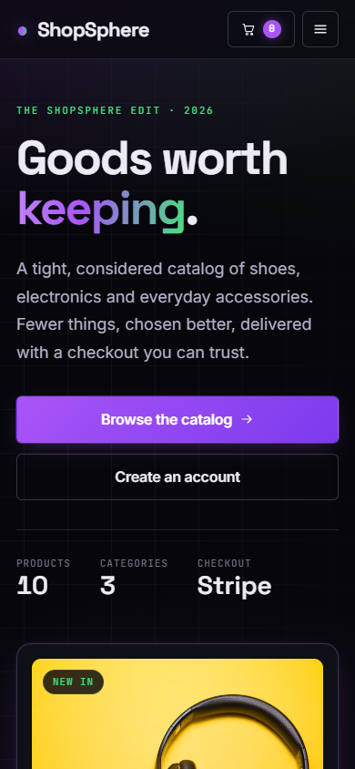

# ShopSphere

A full-stack e-commerce store built with the MERN stack: browse a catalog, manage a cart, pay through Stripe Checkout and track orders, with an admin back office for products and fulfilment.



## Features

**Storefront**
- Product catalog with category filters, live search, sorting and pagination (filters live in the URL, so results are shareable)
- Product pages with stock indicators, a quantity picker and related products
- Cart saved in the browser and re-checked against live prices and stock before checkout
- Secure payment with **Stripe Checkout**; prices are always recalculated on the server
- Order history with a delivery progress tracker, plus cancelling unpaid orders
- Sign up / sign in with JWT auth; protected pages send you back where you were after login

**Admin**
- Dashboard with revenue, paid orders, orders awaiting fulfilment and low-stock alerts
- Create, edit and delete products with a live image preview
- Filter orders by status and move them from Pending → Processing → Shipped → Delivered

**Engineering**
- Stock is decremented exactly once, when Stripe confirms payment (webhook, with a fallback check on the success page for local development)
- Abandoned checkouts are retired automatically when the Stripe session expires
- Centralised error handling with a consistent `{ success, message }` response shape
- Helmet security headers and rate limiting on login and registration
- 59 API integration tests (Node's built-in test runner) and GitHub Actions CI

## Tech stack

| Layer    | Tools |
| -------- | ----- |
| Frontend | React 19, React Router 7, Vite, Axios, hand-written CSS design system |
| Backend  | Node.js, Express 5, Mongoose 9, JWT, bcrypt |
| Payments | Stripe Checkout + webhooks |
| Database | MongoDB (Atlas or local) |
| Tooling  | ESLint, `node --test`, GitHub Actions |

## Screenshots

| Product page | Cart |
| --- | --- |
|  |  |

| Order history | Admin dashboard |
| --- | --- |
|  |  |

<p align="center"></p>

## Getting started

### Prerequisites
- Node.js 20 or newer
- A MongoDB database: [MongoDB Atlas](https://www.mongodb.com/atlas) (free tier) or a local install
- A [Stripe](https://dashboard.stripe.com/register) account in test mode

### 1. Install

```bash
git clone https://github.com/<your-username>/shopsphere.git
cd shopsphere

cd server && npm install
cd ../client && npm install
```

### 2. Configure

```bash
cp server/.env.example server/.env
cp client/.env.example client/.env   # optional, defaults to http://localhost:5000/api
```

Fill in `server/.env`:

| Variable | What it is |
| --- | --- |
| `PORT` | API port (default `5000`) |
| `MONGO_URI` | MongoDB connection string |
| `JWT_SECRET` | Long random string used to sign login tokens |
| `STRIPE_SECRET_KEY` | Stripe test secret key (`sk_test_…`) |
| `STRIPE_WEBHOOK_SECRET` | Webhook signing secret (`whsec_…`, see below) |
| `CLIENT_URL` | Frontend URL, used for CORS and Stripe redirects |
| `SEED_ADMIN_EMAIL` / `SEED_ADMIN_PASSWORD` | Optional admin login created by the seed script |

> Using Atlas? Add your IP address under **Network Access**, or the API can't connect.

### 3. Add sample data

```bash
cd server
npm run seed            # adds 10 products if the catalog is empty
npm run seed -- --reset # replaces all products (orders are kept)
```

The seed script also creates two accounts if they don't exist yet:

| Role | Email | Password |
| --- | --- | --- |
| Admin | `admin@shopsphere.dev` | `admin123` (or `SEED_ADMIN_PASSWORD`) |
| Customer | `shopper@shopsphere.dev` | `shopper123` |

### 4. Run

In two terminals:

```bash
cd server && npm run dev   # API on http://localhost:5000
cd client && npm run dev   # app on http://localhost:5173
```

### 5. Test payments locally

Use Stripe's test card `4242 4242 4242 4242` with any future expiry date and any CVC.

To receive webhooks locally, install the [Stripe CLI](https://stripe.com/docs/stripe-cli) and run:

```bash
stripe listen --forward-to localhost:5000/api/payment/webhook
```

Copy the `whsec_…` secret it prints into `STRIPE_WEBHOOK_SECRET`. Without the CLI, payments still settle when you land on the success page.

## Running the tests

```bash
cd server && npm test     # API integration tests (needs MONGO_URI)
cd client && npm run lint && npm run build
```

The tests create their own uniquely named users, products and orders, and delete them afterwards. They are still best pointed at a local or throwaway database.

## Deployment

A setup that fits in free tiers:

1. **Database:** MongoDB Atlas. Allow access from anywhere (`0.0.0.0/0`) so your host can connect.
2. **API:** [Render](https://render.com) web service with root directory `server`, build command `npm install`, start command `npm start`. Add every variable from `server/.env`, with `CLIENT_URL` set to your frontend URL.
3. **Frontend:** [Vercel](https://vercel.com) project with root directory `client` and the Vite preset. Set `VITE_API_URL` to `https://<your-api>.onrender.com/api`. `client/vercel.json` already routes deep links to the app.
4. **Stripe:** add a webhook endpoint at `https://<your-api>.onrender.com/api/payment/webhook` for `checkout.session.completed` and `checkout.session.expired`, then put its signing secret in `STRIPE_WEBHOOK_SECRET`.
5. Run `npm run seed` once against the production database, with a strong `SEED_ADMIN_PASSWORD`.

## API overview

| Method | Endpoint | Access |
| --- | --- | --- |
| `POST` | `/api/auth/register` · `/api/auth/login` | Public |
| `GET` | `/api/auth/profile` | Signed in |
| `GET` | `/api/products` (`search`, `category`, `sort`, `page`, `limit`) | Public |
| `GET` | `/api/products/:id` | Public |
| `POST` `PUT` `DELETE` | `/api/products[/:id]` | Admin |
| `GET` | `/api/orders/myorders` | Signed in |
| `GET` | `/api/orders/:id` | Owner or admin |
| `PUT` | `/api/orders/:id/cancel` | Owner (unpaid orders only) |
| `GET` | `/api/orders` | Admin |
| `PUT` | `/api/orders/:id/status` | Admin |
| `POST` | `/api/payment/create-checkout-session` | Signed in |
| `GET` | `/api/payment/verify?sessionId=…` | Signed in |
| `POST` | `/api/payment/webhook` | Stripe (signature verified) |

## Project structure

```
shopsphere/
├── client/                 React + Vite frontend
│   └── src/
│       ├── api/            Axios client and endpoint helpers
│       ├── components/     Navbar, product card, route guard, feedback states…
│       ├── context/        Auth, cart and toast providers
│       ├── hooks/          useAsync, useDebouncedValue, useSignOut
│       ├── pages/          Storefront, account and admin screens
│       └── styles/         Design tokens, base, components, pages, theme
├── server/                 Express API
│   ├── scripts/seed.js     Sample data
│   ├── src/
│   │   ├── config/         MongoDB and Stripe clients
│   │   ├── controllers/    Route handlers
│   │   ├── middleware/     Auth, admin, rate limit, errors
│   │   ├── models/         User, Product, Order
│   │   ├── routes/
│   │   └── utils/
│   └── tests/              Integration tests
└── .github/workflows/      CI
```

## Ideas for what's next

- Product reviews and ratings
- Wishlist
- Shipping addresses collected at checkout
- Image uploads (e.g. Cloudinary) instead of image URLs
- Password reset by email
