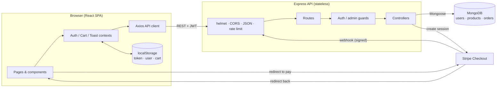
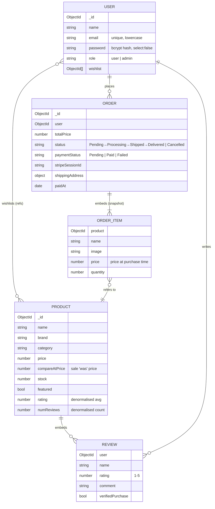
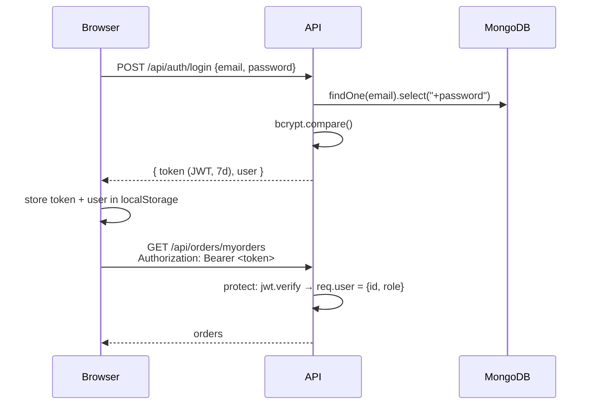
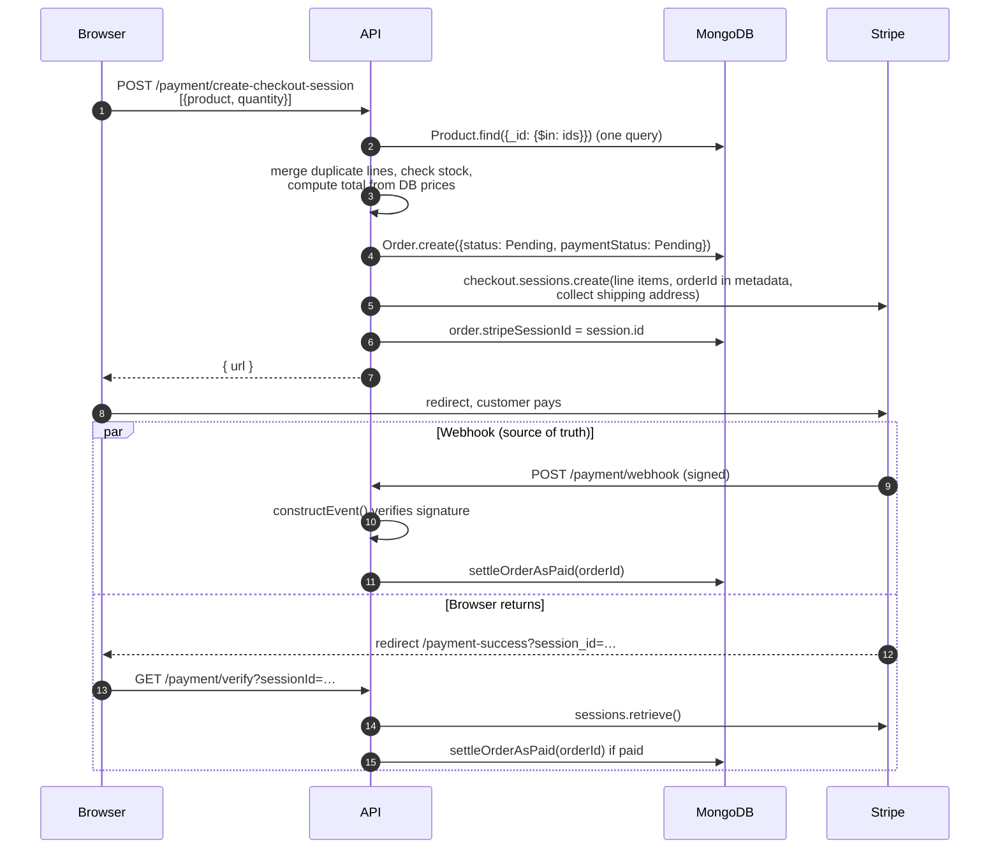
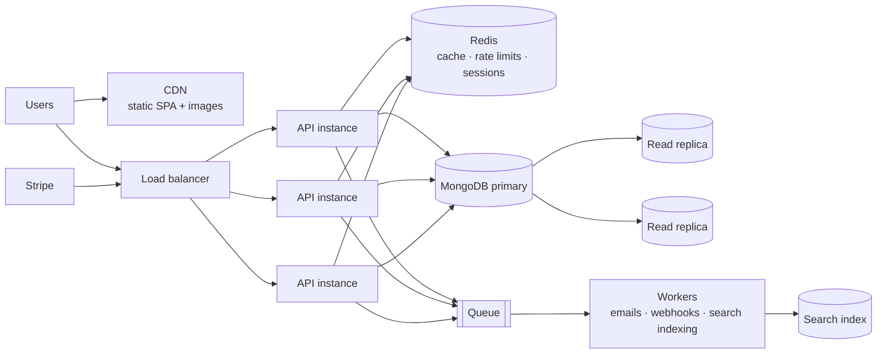

# ShopSphere — System Design

This document explains how ShopSphere is put together and why. Each section ends with the trade-offs, which is usually what interviewers dig into. The last section is a list of likely interview questions with short answers that point back to the code.

---

## 1. Architecture at a glance



| Piece | Responsibility |
| --- | --- |
| **React SPA** (`client/`) | Rendering, routing, optimistic UI, cart storage. Never trusted for prices or permissions. |
| **Express API** (`server/src`) | Validation, authentication, authorization, business rules, persistence. No session state, so any instance can serve any request. |
| **MongoDB** | Source of truth for users, products (with embedded reviews) and orders. |
| **Stripe Checkout** | Hosted payment page. Card data never touches our servers. |

### Request lifecycle

Every API request flows through the same middleware chain (`server/src/app.js`):

1. `helmet()` sets security headers.
2. `cors()` allows only `CLIENT_URL` origins.
3. `express.raw()` handles **only** `/api/payment/webhook` (Stripe signs the raw bytes). `express.json()` handles everything else.
4. A route-specific chain runs, e.g. `protect → adminOnly → controller`.
5. Unmatched routes go to `notFound`, then `errorHandler`, which maps Mongoose and other errors to a consistent `{ success: false, message }` with the right status (400, 401, 403, 404, 409 or 500).

---

## 2. Data model



### Modelling decisions

| Decision | Why | Trade-off |
| --- | --- | --- |
| **Reviews embedded** in the product | Always read with the product, and bounded in number. One read renders the whole page. | A product document grows with reviews. At very large scale, move them to their own collection and paginate. Listings exclude them with `.select("-reviews")`. |
| **Rating and count denormalised** onto the product | Listings and "Top rated" sorting never scan reviews. | They must be recomputed on every review write (`recalculateRating()`). |
| **Order items snapshot** name, image and price | An order must show what the customer actually paid, even if the product is renamed, repriced or deleted. | Duplicate data, which is intentional. |
| **Wishlist as references** on the user | Small, user-owned list. Atomic `$addToSet` / `$pull`. | Needs `populate` to display, and deleted products have to be filtered out. |
| **Categories derived, not stored** | One `$group` aggregation gives names, counts and a cover image. No extra collection to keep in sync. | Fine for dozens of categories. For a hierarchy or SEO metadata, add a `categories` collection. |

### Indexes

```js
// Product
{ category: 1, createdAt: -1 }   // filter by category, newest first
{ price: 1 }                     // price sorts
{ featured: 1, createdAt: -1 }   // home page rail
{ rating: -1, numReviews: -1 }   // "Top rated"
// Order
{ user: 1, createdAt: -1 }       // "My orders"
{ createdAt: -1 }                // admin list
// User
{ email: 1 } unique              // login lookup and duplicate prevention
```

Interview angle: an index should match the query's **equality → sort → range** shape. Without these, every catalog request is a collection scan plus an in-memory sort.

---

## 3. Authentication & authorization



- **Passwords** are hashed with bcrypt (10 salt rounds) in a Mongoose `pre("save")` hook. The hash is `select: false`, so it is never returned by accident.
- **JWT** carries `{ id, role }`, signed with `JWT_SECRET` and valid for 7 days. The API is **stateless**: no session store, so it scales horizontally.
- **Authorization** happens in middleware: `protect` (any signed-in user), `adminOnly` (role check), plus **ownership checks** in controllers (e.g. only the owner can read or cancel an order).
- **Rate limiting** on `/login` and `/register` (20 per 15 minutes per IP) slows down credential stuffing.
- **Mass-assignment protection**: product writes copy only whitelisted fields (`EDITABLE_FIELDS`), so a client can't set `rating`. Order creation ignores client prices entirely.
- The client clears the session and fires a `session-expired` event on any 401, so the UI never acts on a dead token.

**Trade-offs to mention:** a token in `localStorage` is readable by injected scripts (XSS). An `httpOnly` cookie plus CSRF protection is stronger. There are no refresh tokens and no revocation list, so a stolen token works until it expires. The fix is short-lived access tokens, rotating refresh tokens and a deny-list (e.g. in Redis).

---

## 4. Checkout & payments (the most important flow)



### Key design points

1. **The server owns prices.** The client sends only ids and quantities. Prices come from the database at checkout, so a tampered request can't buy at ₹1.
2. **Hosted checkout keeps card data off our servers**, which keeps PCI scope minimal.
3. **Webhooks are the source of truth.** The browser redirect can be lost (closed tab, bad network). Stripe retries webhooks until it gets a 2xx. The `/verify` call is a fallback that makes local development work without a public webhook URL.
4. **Webhook authenticity:** `stripe.webhooks.constructEvent(rawBody, signature, secret)` rejects forged calls. This is why the webhook route gets the raw body.
5. **Idempotent settlement.** Stripe may deliver the same event twice, and the webhook and `/verify` can race each other. `settleOrderAsPaid` is one atomic conditional update:

   ```js
   Order.findOneAndUpdate(
       { _id: orderId, paymentStatus: { $ne: "Paid" } },   // only if not yet paid
       { $set: { paymentStatus: "Paid", paidAt, shippingAddress } }
   )
   ```

   Only the caller that wins the transition gets the document back and decrements stock. `tests/payment.test.js` fires three settlements concurrently and asserts stock drops exactly once.
6. **Lifecycle cleanup.** `checkout.session.expired` cancels abandoned orders. Customers can also cancel unpaid orders, which first expires the Stripe session so it can't be paid afterwards.

### Inventory consistency

Stock is decremented **when payment settles**, with a guarded atomic update:

```js
Product.findOneAndUpdate(
    { _id, stock: { $gte: qty } },     // never go negative
    { $inc: { stock: -qty } }
)
```

**Trade-off:** two customers can both start checkout for the last unit, and both may pay. The guard prevents negative stock, but one order then can't be fulfilled (it's logged for follow-up). Alternatives:

| Strategy | How | Cost |
| --- | --- | --- |
| Decrement on payment (current) | Simple; no stock is held by abandoned carts | Rare oversell at the very end of stock |
| **Reserve at checkout** | Decrement when the session is created, restore on expiry or cancel | Abandoned checkouts hold stock for up to 24h (shorten the session TTL) |
| Multi-document transaction | `session.withTransaction()` around order + stock | Needs a replica set; more latency |

---

## 5. Catalog & search

- **Filtering:** category, featured and on-sale (`$expr: { $gt: ["$compareAtPrice", "$price"] }`), plus search on name or brand.
- **Sorting** includes `_id` as a tiebreaker, so pagination is deterministic.
- **Pagination** is offset-based (`skip/limit`), with `page`, `pages` and `total` returned. That's fine for small catalogs. At scale, `skip` gets slower the deeper you go; **cursor pagination** (`createdAt < lastSeen`) is constant-time.
- **Search** uses an escaped, case-insensitive regex (escaped so `.*` can't become a ReDoS or a match-everything). Regex can't use an index efficiently. Next steps: a MongoDB text index, then Atlas Search or Elasticsearch for relevance, typo tolerance and facets.
- **No N+1:** cart validation fetches all products with one `$in` query instead of one query per item.
- **Categories** are one aggregation pipeline (`$addFields → $sort → $group → $project`) that also picks each category's cover image.

---

## 6. Concurrency patterns used

| Problem | Where | Technique |
| --- | --- | --- |
| Double settlement / double stock decrement | Payments | Atomic conditional update (`paymentStatus: {$ne: "Paid"}`) |
| Negative stock | Payments | Guarded `$inc` with `stock: {$gte: qty}` |
| Duplicate wishlist entries from double taps | Wishlist | `$addToSet` / `$pull` (atomic, idempotent) |
| Two reviews saved at the same moment | Reviews | Mongoose **optimistic concurrency** (document version). A conflict raises `VersionError`, mapped to **409**, and the client retries |
| Duplicate accounts | Register | Unique index on `email` (DB-level guarantee) plus a friendly pre-check |

---

## 7. Frontend architecture

- **Routing:** React Router with a `ProtectedRoute` guard. It remembers the page you were headed to and returns you there after login.
- **State:** three small contexts instead of a global store:
  - `AuthProvider`: token and user (including wishlist ids), synced across tabs via the `storage` event, and cleared on any 401.
  - `CartProvider`: the cart in `localStorage`. On the cart page it **reconciles** with live prices and stock (`syncCart`).
  - `ToastProvider`: notifications.
- **Data fetching:** a tiny `useAsync` hook keyed on its dependencies. It keeps previous data visible while refetching (no flashing) and exposes `setData` for local updates after mutations.
- **Optimistic UI:** wishlist hearts and admin status changes update immediately, then reconcile with the server's response or roll back on error.
- **URL as state:** catalog filters (`category`, `sort`, `sale`, `page`) live in the query string, so results are shareable and Back works.
- **Caching:** the categories request is shared and cached for 60s, since the navbar, home page, footer and admin form all need it.

---

## 8. Security checklist

- [x] bcrypt password hashing; hash never selected by default
- [x] JWT verification on protected routes; role and ownership checks
- [x] Server-side pricing; client prices ignored
- [x] Whitelisted writable fields (no mass assignment)
- [x] Stripe webhook signature verification
- [x] Helmet security headers; CORS restricted to known origins
- [x] Rate limiting on authentication endpoints
- [x] Regex input escaped (no ReDoS or wildcard search)
- [x] Centralised error handler (no stack traces leaked to clients)
- [ ] httpOnly cookie sessions with CSRF protection (see trade-offs above)
- [ ] Request schema validation library (e.g. zod or Joi) for every endpoint

---

## 9. Testing & delivery

- **84 integration tests** (`node --test`) run the real Express app against a real MongoDB. They cover auth, catalog filters, reviews, the wishlist, orders, access control, cancellation and **concurrent payment settlement**.
- Tests create uniquely named data per run and delete it afterwards.
- **GitHub Actions CI** spins up a MongoDB service container, runs the API tests, then lints and builds the client on every push.

---

## 10. How it would scale



| Bottleneck | Fix |
| --- | --- |
| API CPU / traffic | Stateless already, so add instances behind a load balancer |
| Catalog reads dominate | Cache listings and categories in Redis (short TTL, invalidate on admin writes); serve reads from replicas |
| Images | Object storage (S3 or Cloudinary) behind a CDN, with resized variants |
| Rate limiter is per-instance memory | Move the counter store to Redis so limits hold across instances |
| Webhook bursts / slow side effects | Acknowledge fast, push the work onto a queue (e.g. BullMQ), process in workers |
| Search quality / speed | Atlas Search or Elasticsearch, fed by change streams |
| Orders collection growth | Shard by `user`; archive old orders |
| Observability | Structured logs, request ids, metrics (p95 latency, error rate), alerting on webhook failures |

---

## 11. Interview questions this project prepares you for

**How do you stop a customer changing the price?**
The client sends only product ids and quantities. The server loads prices from MongoDB and builds the Stripe line items itself (`utils/cart.js`, `paymentController.createCheckoutSession`).

**Stripe sends the same webhook twice. What happens?**
Nothing bad. Settlement is an atomic conditional update that only succeeds while the order is unpaid, so the second delivery is a no-op and stock is decremented once (`settleOrderAsPaid`, proven in `tests/payment.test.js`).

**Why both a webhook and a /verify endpoint?**
The webhook is the reliable source of truth, because Stripe retries it. The redirect-based verify gives instant feedback and works locally without a public URL. Both call the same idempotent function.

**Why embed reviews but reference wishlist items?**
Reviews belong to a product, are read with it and are bounded, so embedding means one read. Wishlist entries point at independently changing products and are per user, so they're references updated with atomic set operations.

**How would you prevent overselling the last item?**
Reserve stock when checkout starts (decrement, then restore on expiry or cancel), or use a transaction. Explain the trade-off against stock held by abandoned carts (section 4).

**Why is the API stateless, and what does that buy you?**
JWT auth means no server-side session, so any instance can serve any request and you scale by adding instances. The cost is harder token revocation.

**Offset vs cursor pagination?**
Offset (`skip`) is simple and supports page numbers, but slows down as the offset grows and can skip or duplicate items while data changes. A cursor (`createdAt < last`) is constant-time and stable, but makes "jump to page 7" harder.

**What's an N+1 query, and did you have one?**
Querying once per item in a loop. Cart validation used to call `findById` per line. It now uses one `$in` query and a map (`utils/cart.js`).

**How do you keep a denormalised field correct?**
Every write that affects it recomputes it in the same save (`recalculateRating()`), and only the server writes it (it's excluded from `EDITABLE_FIELDS`).

**What would you change for production?**
httpOnly cookie auth with refresh tokens, schema validation on every route, stock reservation, Redis for caching and rate limits, image uploads to a CDN, structured logging and monitoring, and email notifications through a queue.
